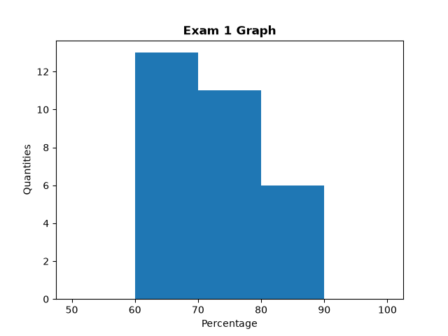

# Student Grade Tracker and Assignment Analytics

A CLI-based Python application designed to calculate student's grade, assignment analytics, and display graph of those analytics

# 📁 Directory Structure

Ensure your project folder is organized as follows:
```commandline
.
├── Lab11.py
└── data/
   ├── students.txt
   ├── assignments.txt
   └── submissions/
      ├── submission_1.txt
      ├── submission_2.txt
      └── ...
```


# 📋 Data File Formats

## data/students.txt:

--- Contains student information where the first 3 characters is Student ID and Student Name after ID without any space

```
   101John Doe
   102Jane Smith
```

## data/assignments.txt

--- Structured in groups of 3 lines per assignment:

- Line 1: Assignment Name
- Line 2: Assignment ID
- Line 3: Assignment Point

```
  Lab 1
  1001
  100
  Lab 2
  1002
  50
```
## data/submissions/\*.txt

--- Each text file inside data/submissions/ is a submissions following structure: Student ID|Assignment ID|Percentage:

```
   894|81043|72
   511|68047|64
```

# ⚡ Technology

- Python 3.x
- ```matplotlib``` library

Install library dependencies via pip:

```bash
$ pip install matplotlib
```
# 🚀 Usage

Run the main script:
```commandline
$ python3 Lab11.py
```

# 📊 Graphing Example
